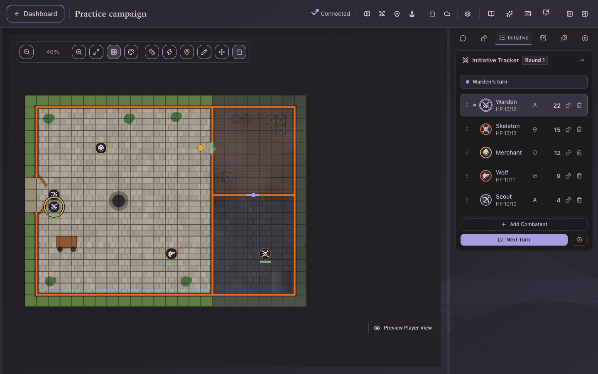
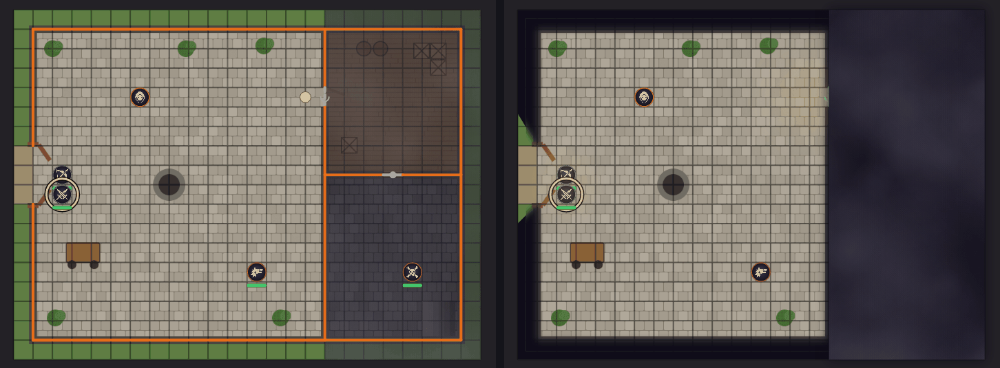
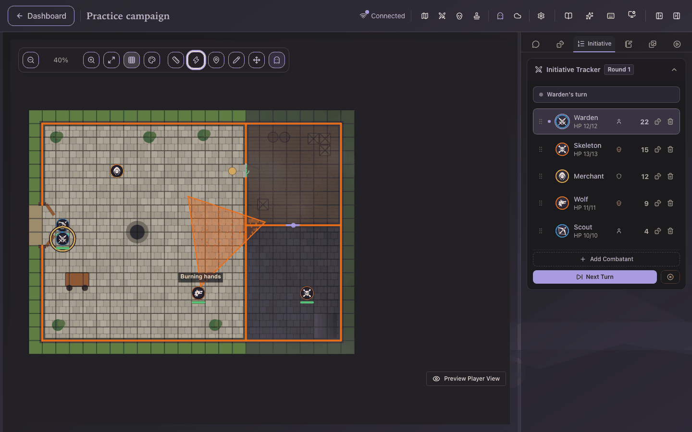
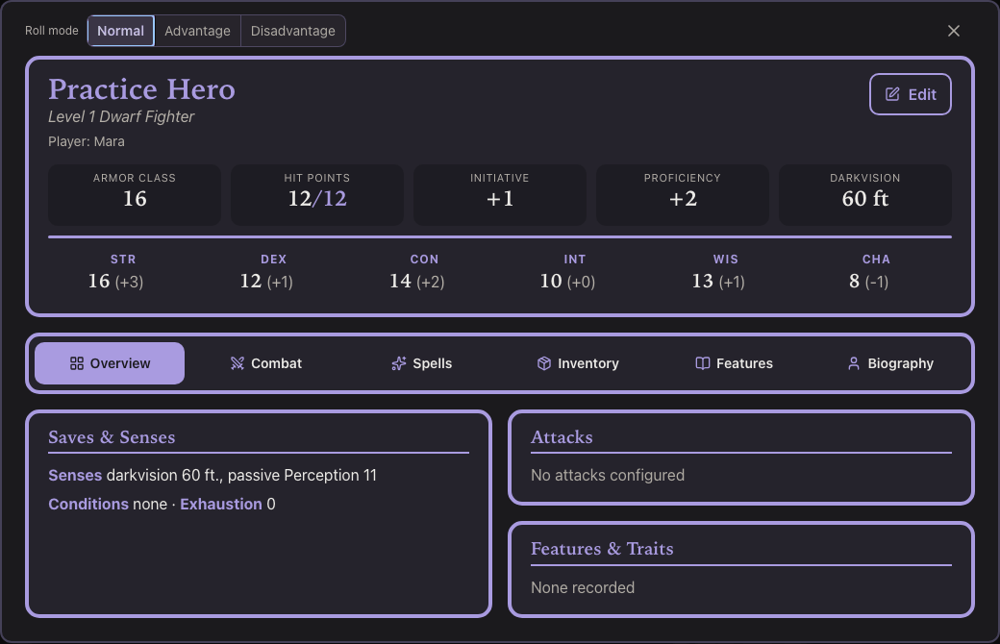
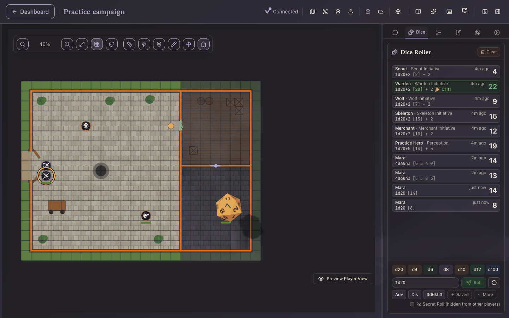
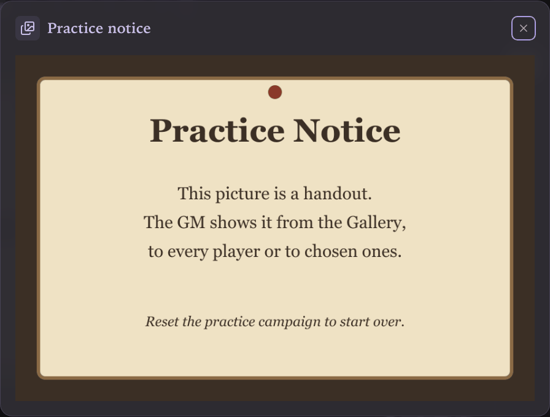
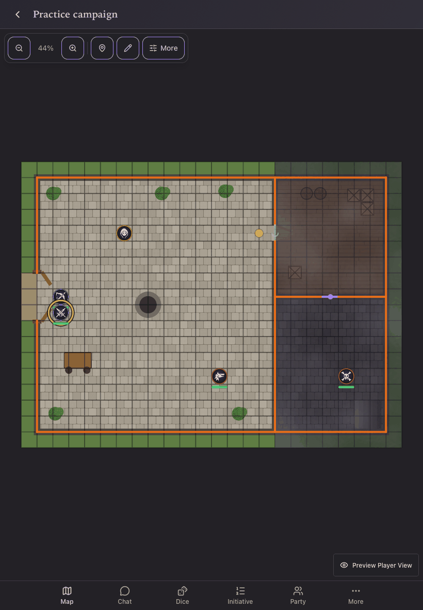

<p align="center">
  
</p>

# Mistwarden

Mistwarden is a self-hosted, browser-based virtual tabletop for tabletop role-playing campaigns: maps with tokens, fog of war and dynamic lighting, dice, chat, character sheets and a GM toolbox, running on your own server with your own data. It is a modified version of [CozyVTT](https://github.com/CheekyChinchilla/CozyVTT) 1.7.0 by CheekyChinchilla (AGPL-3.0), with its own look and extra features, and is not affiliated with or endorsed by the CozyVTT project. CozyVTT's copyright notices and licences stay in place; see [Changes from CozyVTT](#changes-from-cozyvtt).

> **You run it, you secure it.** Mistwarden is community software, provided as-is under the [AGPL-3.0](LICENSE), with no warranty and no central support. Do not expose it to the internet without reading the [hardening checklist](docs/DEPLOYMENT.md). If those words mean nothing to you, keep it on your local network (LAN, Tailscale, ZeroTier). Report security issues privately per [SECURITY.md](SECURITY.md).

## Screenshots

All pictures are taken in the built-in practice campaign, whose map and pictures are drawn for Mistwarden.



*The map table with the initiative tracker.*



*Dynamic lighting and fog of war: the GM's view (left) and what a player sees (right).*



*A spell area (a 30 ft cone, fire look) placed on the map.*



*The 5E character sheet, Overview tab.*



*A 3D d20 mid-roll, with the roll history in the Dice panel.*



*A picture from the campaign gallery, shown as a handout.*



*The compact layout on a tablet held upright: map across the screen, bottom bar.*

## Features

### Table and map
- Multiple campaigns on one server, isolated from each other; roles Platform Admin, GM, Player and Spectator.
- Map canvas with tokens (player, NPC, object), HP bars, conditions, stat blocks, facing and three display modes. Click a token to pick it up, click a square to put it down; arrow keys also move a selected token.
- Upload maps, import Universal VTT files (`.uvtt`, `.dd2vtt`, `.df2vtt`) with walls, doors and lights, export maps back out, or draw a map in the built-in Mapmaker.
- Square or hex grids (point-up or flat-top), a grid offset, and grid auto-detection that suggests a size and offset for an uploaded map picture. Tokens snap to the grid by default; a map can let them rest between squares.
- Tokens can ride a mount and move with it. A token without a picture is drawn as a symbol for its creature type (from game-icons.net, CC BY 3.0) with a name plate, and the GM can keep a token's name from the table.
- Spell areas on the map (circle, cone, line, cube, with a fire, cold or similar look), placed by hand or from a spell in the Spell Library, with the tokens they touch listed.
- GM can prepare another map on their own screen while the table plays, then bring everyone over.
- Initiative tracker, map pings, drawing tools and a laser pointer, vibe tracker (time-of-day tints), ambient effects and audio, session start/pause/end with recaps.
- Asset library: upload pictures and sound, or import a ZIP of pictures.
- Campaign gallery: pictures filed in folders and shown to chosen players.
- Documents (PDF, text, Markdown), personal notes, whispers and chat.
- Campaign export/import as `.cozyvtt` archives (the gallery is not part of the export).

### Vision and fog
- Fog of war by box, brush or lasso, with rounded edges and drifting mist (the mist can be set still or flat per device).
- Dynamic lighting: walls, doors and windows with raycast line of sight, lights with presets and colours, global-illumination switch per map.
- Darkvision per token, with carried lights (a torch or lantern that follows its token); lights update live while you drag them.
- Explored areas are remembered per player and can be reset.
- Hidden tokens and fog are filtered on the server; players are not sent what they cannot see.

### Characters
- Character sheets for 5th-edition SRD 5.1 rules, with an Overview tab, portrait, accent colours and a darkvision field that updates linked tokens.
- Sheets for a fantasy d20 system (ORC), a horror d100 system, and free-form JSON sheets.
- SRD creature library (imported by an admin), custom creatures and token templates. Admins can also import stat blocks written as Markdown (5e style), with a dry run first.
- Spell Library: the SRD 5.1 spells (an admin imports them from Open5e, with the area read from the spell text), spells you add to a campaign, and spells an admin imports from Markdown. Campaign spells travel with the campaign export.
- Dice notation (`1d20+5`, `4d6kh3`, advantage/disadvantage), secret rolls, saved rolls, roll history, NPC rolls from stat blocks, and 3D dice animation (a CSS fallback is used where it is not available).

### Players and devices
- Compact layout below 1,024 px width: map across the screen, a bottom bar, panels as sheets; touch gestures for tokens, pings and drawing; 44 px touch targets.
- "Display on this device" settings (fog look, dice animation) are stored per browser.
- Keyboard and screen reader support for dialogs, chat, dice and token movement.
- Installable to the home screen (web app manifest).
- Per-user themes and fonts (served by your own instance, no third-party fetches).
- Two-factor authentication (TOTP) with backup codes, required for administrators.

### GM tools
- Optional writing help for GMs (an NPC, read-aloud text, notes) through an AI provider you configure. Off unless `AI_PROVIDER` is set; the key stays on the server.
- Admin Panel: users, invitations, settings, activity log, uploaded files, instance backups.
- Practice campaign: every user can open one small campaign of their own (map, walls, a door, a light, fog, a character, a note) to try the tools on, and reset it to how it was made.
- Setup wizard guarded by a one-time setup token printed in the backend log.

### Automation and MCP
- [MCP server](mcp/README.md) that lets a coding assistant build scenes from your own campaign notes and map pictures on your computer, as the GM, with a manifest of what it created.
- REST routes for the GM's table actions (chat, dice, vibe, atmosphere, spell areas, resetting explored memory) and for the initiative tracker, which the MCP server uses; see the [API reference](docs/API_REFERENCE.md).

## Quick start

Requirements:

- Docker 24+ with Docker Compose v2 (recommended install)
- Node.js 26+ and PostgreSQL 14+, only to install without Docker (see [Manual Deployment](docs/DEPLOYMENT.md#manual-deployment))
- Chrome or Edge 111, Firefox 128 or Safari 16.4 (iPadOS 16.4) or newer
- SMTP server (optional; needed for password reset and invitation emails)

```bash
git clone https://github.com/robinesken97/mistwarden.git
cd mistwarden
cp .env.example .env
# Edit .env: set DATABASE_PASSWORD and SESSION_SECRET (openssl rand -hex 32)
docker compose up -d --build
```

- There are no default passwords. The production build refuses to start while `DATABASE_PASSWORD` or `SESSION_SECRET` is still the placeholder, or while `SESSION_SECRET` is shorter than 32 characters.
- Open `http://localhost` and complete the setup wizard. It asks for a one-time setup token: `docker compose logs backend | grep "setup token"` shows it. The first account becomes the administrator, who must enable two-factor authentication within 7 days.
- Set `CORS_ORIGIN` to your public address. Use HTTPS for anything beyond localhost (the home-screen app needs a secure origin): Let's Encrypt with the bundled nginx, or a reverse proxy such as Caddy, Traefik or a Cloudflare Tunnel. See [docs/DEPLOYMENT.md](docs/DEPLOYMENT.md).
- Security posture: the backend container drops to an unprivileged user; in the nginx containers the master process runs as root, as nginx's own image does, and every container drops every Linux capability except the few its start-up needs.

## Updating and backups

Update:

```bash
git pull
docker compose up -d --build
```

If `git pull` stops because you edited `docker-compose.yml`, see [Updating after you've edited docker-compose.yml](docs/DEPLOYMENT.md#updating-after-youve-edited-docker-composeyml); a `docker-compose.override.yml` avoids the conflict.

Backups:

- Admin Panel, Backups, Create Backup: a ZIP with a database dump and all uploaded files, written to `backend/backups/`. Backups are never deleted automatically.
- `./backend/scripts/backup.sh` writes a gzip database dump and, beside it, an archive of the uploaded files to `./backups/` (`BACKUP_UPLOADS=no` skips the files); `./backend/scripts/restore.sh <dump>` restores both when the archive sits beside the dump.
- Daily cron example: [Automated Daily Backups](docs/DEPLOYMENT.md#automated-daily-backups-cron).

## Configuration

Settings live in `.env` (copy `.env.example`, which documents every key) and in the Admin Panel. Common ones:

| Variable | Purpose |
|----------|---------|
| `DATABASE_PASSWORD`, `SESSION_SECRET` | Required; placeholders are refused in production |
| `CORS_ORIGIN`, `APP_URL` | Public address of the instance; base for email links |
| `HTTP_PORT`, `HTTPS_PORT` | Published ports of the bundled nginx |
| `NGINX_TRUSTED_PROXIES` | Proxies in front of nginx whose client addresses are trusted |
| `SETUP_TOKEN` | Choose the one-time setup token yourself (optional) |
| `SMTP_HOST`, `SMTP_PORT`, `SMTP_USER`, `SMTP_PASS`, `SMTP_FROM`, `SMTP_SECURE` | Email for password reset and invitations (optional) |
| `MAX_MAP_SIZE_MB`, `MAX_TOKEN_SIZE_MB`, `MAX_AUDIO_SIZE_MB`, `MAX_AVATAR_SIZE_MB`, `MAX_DOCUMENT_SIZE_MB`, `NGINX_MAX_BODY_SIZE` | Upload limits; raise the proxy limit with them |
| `AI_PROVIDER`, `AI_API_KEY`, `AI_MODEL`, `AI_BASE_URL`, `AI_RATE_LIMIT` | Optional writing help; off unless `AI_PROVIDER` is set |
| `SESSION_MAX_AGE`, `REMEMBER_ME_MAX_AGE`, `RATE_LIMIT_MAX_REQUESTS` | Session lifetimes and API rate limit |

Full reference: [docs/DEPLOYMENT.md](docs/DEPLOYMENT.md#environment-configuration) and [docs/DEVELOPMENT.md](docs/DEVELOPMENT.md).

## MCP server

`mcp/` holds a stdio MCP server that runs on your computer and signs in with your own GM session (it never sees your password). It reads notes and pictures only from one folder you name, acts only on GM campaigns, and by default changes only objects it created itself. By default it only creates and changes its own objects, and what it does stays hidden from players; three opt-in switches widen that: `MISTWARDEN_MCP_COGM=1` (co-GM: game state, initiative, chat, dice, sessions), `MISTWARDEN_MCP_PLAYER_VISIBLE=1` (tools that show things to players and changes on the map they see) and `MISTWARDEN_MCP_ALLOW_ANY_EDIT=1` (edit or delete objects it did not create). Deletes need a recent `create_backup`. Tool groups: read, maps, tokens, creatures and spells, spell areas, walls and lights, fog, notes and gallery, characters, dice, local files, instance library import (platform admins), backup, and table tools. Setup, tools and the safety model: [mcp/README.md](mcp/README.md).

Mistwarden's HTTP and WebSocket surfaces are not a public API: they are what the web client calls, are not versioned and can change in any release. Tools built on them, such as the independent [cozyvtt-mcp](https://github.com/yanjingzhaisun/cozyvtt-mcp) bridge, must check compatibility themselves.

## Development

Dev stack with hot reload: `docker compose -f docker-compose.dev.yml up`. Details, running outside Docker and tests: [docs/DEVELOPMENT.md](docs/DEVELOPMENT.md). Also see [Architecture](docs/ARCHITECTURE.md), [Contributing](docs/CONTRIBUTING.md), [API reference](docs/API_REFERENCE.md), [GM guide](docs/GM_GUIDE.md), [Player guide](docs/PLAYER_GUIDE.md) and the [Changelog](CHANGELOG.md).

Stack: React 19 + Vite + Tailwind (frontend), Node.js + Express + Prisma + PostgreSQL + Socket.io (backend).

## Roadmap

Backlog and known issues: [docs/FUTURE_FEATURES.md](docs/FUTURE_FEATURES.md).

## Licence and credits

GNU Affero General Public License v3.0, see [LICENSE](LICENSE). Any modified version you run as a network service must make its source available under the same licence.

- Based on [CozyVTT](https://github.com/CheekyChinchilla/CozyVTT) by CheekyChinchilla.
- Fonts, icons, pictures and libraries: [THIRD_PARTY_CREDITS.md](THIRD_PARTY_CREDITS.md) and [THIRD_PARTY_NOTICES.txt](THIRD_PARTY_NOTICES.txt).
- The open game rules (SRD 5.1 under CC BY 4.0, rules released under the ORC License) keep their own licences: [GAME_CONTENT_NOTICES.md](GAME_CONTENT_NOTICES.md). The app shows their credits in About Mistwarden.

---

## Changes from CozyVTT

As the AGPL-3.0 asks, Mistwarden marks what it changed. Source files carry a dated "Modified for Mistwarden" note; files that cannot hold a note are listed here.

- 2026-11-24 — Mistwarden 1.0.0: the version restarts at 1.0.0 in both `package.json` and lock files, `backend/docs/API_DOCUMENTATION.yaml`, `docs/API_REFERENCE.md` and `docs/DEPLOYMENT.md`; `CHANGELOG.md` opens with Mistwarden's releases above CozyVTT's history.
- 2026-11-24 — Mistwarden name in the README, the interface's messages, emails, the authenticator issuer and the example settings, and the quoted notice in `docs/USER_GUIDE.md`; the archive format (`.cozyvtt`, `exportedFrom`) and the licence and game-content notices still name CozyVTT.
- 2026-11-24 — Mistwarden look: the Mistwarden theme and font (the new defaults; CozyVTT's themes and fonts stay selectable), the Mistwarden name in page headers, the browser tab, setup and sign-in, the lantern and night scene, and the About window's note that Mistwarden is based on CozyVTT. Files without a note: `frontend/public/default-logo.png`, `default-mascot.png`, `favicon-32.png`, `favicon-192.png`, `apple-touch-icon.png`, `icon-512.png`, `manifest.webmanifest`, `assets/default-logo.png` (the lantern in place of CozyVTT's artwork). `frontend/index.html` has its note as an HTML comment.
